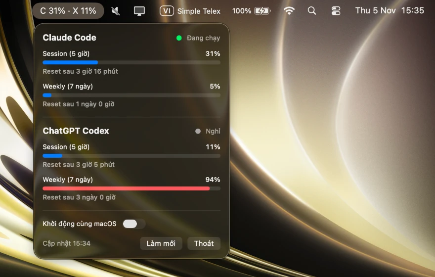

# AI Usage Monitor

App menu bar siêu nhẹ cho macOS (13+) theo dõi mức sử dụng **Claude Code** và **ChatGPT Codex**.

Hiển thị cho từng provider: trạng thái (đang chạy / nghỉ), session usage (cửa sổ 5 giờ), weekly usage (7 ngày) và thời gian reset.



## Cài đặt

```bash
./scripts/install.sh
```

Build và cài vào `/Applications/AIUsageMonitor.app` rồi mở app. Sau đó mở từ Spotlight/Launchpad như app thường.
Bật **Khởi động cùng macOS** trong popover để app tự chạy khi đăng nhập.

Đóng gói DMG để chia sẻ: `./scripts/package-dmg.sh` → `build/AIUsageMonitor.dmg`
(app ký ad-hoc, máy khác cần chuột phải → Open lần đầu để qua Gatekeeper).

## Nguồn dữ liệu

| Provider | Usage | Trạng thái |
|---|---|---|
| Codex | `rate_limits` trong `~/.codex/sessions/**/*.jsonl` (chỉ đọc local) | log được ghi trong 2 phút gần nhất |
| Claude Code | `GET api.anthropic.com/api/oauth/usage` với token Claude Code trong Keychain | log trong `~/.claude/projects` được ghi trong 2 phút gần nhất |

- Lần đầu macOS sẽ hỏi quyền đọc Keychain (`security`) → chọn **Always Allow**.
- Endpoint usage của Claude chưa được công bố chính thức, có thể thay đổi.
- Dữ liệu local làm mới mỗi 30 giây; API Claude tối đa 3 phút/lần (nút "Làm mới" gọi ngay).

## Kiểm tra không cần UI

```bash
AIUM_SNAPSHOT=/tmp/popover.png ./build/AIUsageMonitor.app/Contents/MacOS/AIUsageMonitor
```

Render popover ra PNG, in tiêu đề menu bar rồi thoát.
